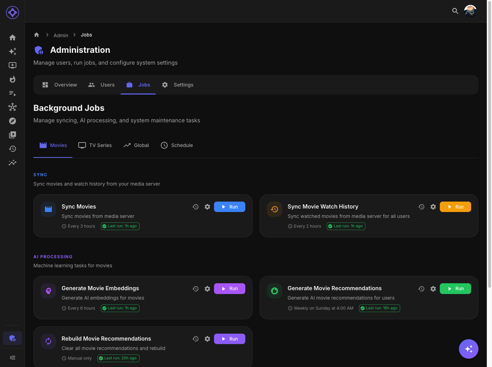

# Job Scheduling

Configure when background jobs run automatically.



## Accessing Schedules

Navigate to **Admin → Jobs**, then click the **gear icon** on any job.

---

## Schedule Types

### Daily

Run at the same time every day.

| Setting | Example |
|---------|---------|
| **Time** | 2:00 AM |
| **Runs** | Every day at 2:00 AM |

Best for: Regular maintenance, sync jobs

### Weekly

Run on a specific day and time.

| Setting | Example |
|---------|---------|
| **Day** | Sunday |
| **Time** | 4:00 AM |
| **Runs** | Every Sunday at 4:00 AM |

Best for: Heavy jobs, recommendations

### Interval

Run every 15 or 30 minutes, or every N hours. Hourly intervals can use a minute
offset to stagger work. For example, every 3 hours at :20 runs at 00:20, 03:20,
06:20, and so on in the server's scheduling timezone.

| Setting | Example |
|---------|---------|
| **Hours** | 2 |
| **Runs** | Every 2 hours |

Options: 15 or 30 minutes; 1, 2, 3, 4, 6, 8, 12 hours

Best for: Watch history, frequent updates

### Manual Only

No automatic schedule. Only runs when manually triggered.

Best for: One-time jobs, troubleshooting

---

## Default Schedules

| Job | Default Schedule |
|-----|------------------|
| **User Sync** | Every 30 minutes |
| **Database Backup** | Daily at 2:00 AM |
| **Movie Catalog Sync** | Every 3 hours at :00 |
| **TV Catalog Sync** | Every 3 hours at :10 |
| **TV Watch History** | Every hour at :05 |
| **Movie Watch History** | Every 2 hours at :15 |
| **Movie Library Publishing** | Every 3 hours at :20 |
| **TV Library Publishing** | Every 3 hours at :30 |
| **Watching / Favorites** | Every hour at :45 |
| **Movie / TV Embeddings** | Every 6 hours at :10 / :20 |
| **Recommendations** | Weekly (Sunday 4:00 AM) |
| **Top Picks** | Daily at 5:00 AM |
| **Metadata Enrichment** | Every 6 hours |
| **Discovery** | Daily at 6:00 AM |

Emby-heavy jobs wait for earlier Emby work to finish, including manual runs. A
queued job shows **Queued** and can be cancelled before it starts. Its scheduled
time is when it becomes eligible to run; work can start later while another
Emby job finishes.

Recommendation library publishing preserves unchanged files and skips unchanged
library refreshes. Aperture manages refreshes for these generated libraries;
their automatic filesystem monitoring and duplicate thumbnail/marker extraction
are disabled. Normal source libraries keep their settings.

---

## Configuring Schedules

### Steps

1. Navigate to Admin → Jobs
2. Find the job to configure
3. Click the **gear icon** (⚙️)
4. Select schedule type
5. Set parameters (time, day, interval)
6. Click **Save**

### Schedule Dialog

| Field | Description |
|-------|-------------|
| **Type** | Daily/Weekly/Interval/Manual |
| **Time** | Hour and minute (for Daily/Weekly) |
| **Day** | Day of week (for Weekly) |
| **Interval** | Hours between runs (for Interval) |
| **Minute** | Minute of the hour for daily, weekly, and hourly interval schedules |

Saving a schedule and turning a job on or off preserve its minute offset.

---

## Schedule Strategy

### Avoid Overlap

If jobs run simultaneously:
- One runs, others queue
- Can cause delays
- Stagger start times

Example:
- 2:00 AM - Sync Movies
- 2:30 AM - Sync Series
- 3:00 AM - Embeddings

### Consider Dependencies

Schedule dependent jobs after prerequisites:

```
2:00 AM - sync-movies
3:00 AM - generate-movie-embeddings (needs movies)
4:00 AM - generate-movie-recommendations (needs embeddings)
5:00 AM - sync-movie-libraries (needs recommendations)
```

### Respect Rate Limits

AI and external API jobs may hit rate limits:
- Space out API-heavy jobs
- Consider daily limits (OMDb)
- Monitor for rate limit errors

---

## Timing Considerations

### Time Zones

Schedules use the container's `TZ` setting, defaulting to `America/New_York`.
The schedule dialog displays this timezone. Next-run timestamps come from the
server's active schedule, so a browser in another timezone uses the same run
instant.

### Off-Peak Hours

Run heavy jobs during off-peak:
- Overnight (1 AM - 6 AM)
- When users aren't active
- Consider media server scan times

### Quick Jobs

Some jobs are fast and can run frequently:
- Watch history sync
- User sync
- Top Picks refresh

---

## Monitoring Scheduled Jobs

### Next Run

The Jobs page shows a countdown calculated from the server's next scheduled run,
including its minute offset. The next run describes the next scheduled trigger;
an active job can be running or queued independently of that countdown.

### Missed Runs

Jobs resume at their next scheduled time after Aperture starts. Missed scheduled
runs are not automatically replayed. Use the run button if a job needs to run
immediately.

---

## Disabling Schedules

To stop automatic runs:

1. Click gear icon on job
2. Select "Manual Only"
3. Save

Job will only run when manually triggered.

---

## Recommended Configurations

### Small Library (<500 items)

| Job | Schedule |
|-----|----------|
| Sync | Daily at 2 AM |
| Embeddings | Daily at 3 AM |
| Recommendations | Daily at 4 AM |
| Library Build | Daily at 5 AM |

### Medium Library (500-2000)

| Job | Schedule |
|-----|----------|
| Sync | Daily at 2 AM |
| Embeddings | Daily at 3 AM |
| Recommendations | Weekly Sunday |
| Library Build | Weekly Sunday |

### Large Library (2000+)

| Job | Schedule |
|-----|----------|
| Sync | Daily at 1 AM |
| Embeddings | Weekly Saturday |
| Recommendations | Weekly Sunday |
| Library Build | After recommendations |

---

## Troubleshooting

### Job Not Running on Schedule

1. Check schedule is saved
2. Verify Aperture is running
3. Check server time/timezone
4. Look for queued state

### Jobs Taking Too Long

1. Check job isn't stalled
2. Review resource usage
3. Consider longer intervals
4. Run during quieter times

### Frequent Failures

1. Review error logs
2. Check prerequisites (API keys, etc.)
3. Verify network connectivity
4. Consider less frequent schedule

---

**Previous:** [Jobs Overview](jobs-overview.md) | **Next:** [Movie Jobs](movie-jobs.md)
