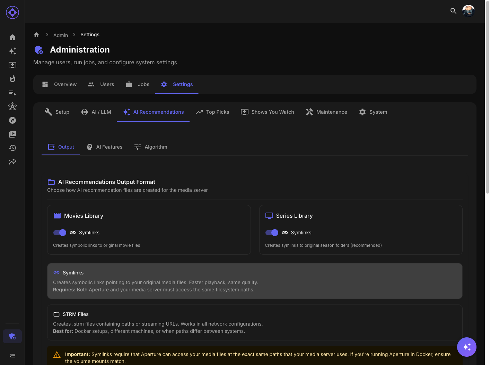

# Output Format Configuration

Configure how Aperture creates virtual libraries in your media server.



## Accessing Settings

Navigate to **Admin → Settings → AI Recommendations → Output**

---

## Output Formats

Choose a publishing mode independently for movies and TV:

| Format | Description |
|--------|-------------|
| **Generated library** | Publish a virtual library with STRM files or symlinks |
| **Private Emby playlist (preview)** | Publish original Emby items into a managed playlist owned by the recipient |
| **Off** | Remove managed output from the media server while keeping recommendations available in Aperture |

---

## Emby permissions and playback

For generated movie and TV libraries, Aperture checks which source libraries the recipient can access and verifies the exact file path against Emby before writing links. TV symlinks point to individual verified episodes. Aperture clears stale links on sync and withholds output when it cannot verify access or another active non-admin can see the generated library, including through **All folders**. This check does not edit other users’ Emby permissions.

The private playlist preview needs the recipient’s Emby session. Each recipient must sign into Aperture with Emby before publication. Aperture creates and updates the managed playlist using that session and checks that other active non-admins cannot see it. A playlist references the original Emby items, while a generated library creates separately indexed items. Playlist placement varies by client. In Emby 4.10, users can choose a playlist for a Home Screen section.

When switching modes, Aperture cleans up managed output from the old mode. If Emby is unavailable or a playlist owner’s session has expired, the next sync can retry cleanup. Run the relevant library sync to publish after a mode change.

### Pin an Emby playlist to Home

After a library sync creates a private Aperture-managed playlist, open **AI Picks → Emby Home** as the playlist recipient and choose **Pin to Emby Home**. This requires Emby’s Home Sections API and an active Emby sign-in to Aperture. Refresh Emby Home to see the shelf.

**Unpin from Emby Home** removes the section Aperture created for that playlist. Existing Emby shelves, their settings and order, and the playlist itself stay in place. Shelves added directly in Emby remain manageable there.

## STRM Files

### What Are STRM Files?

STRM files are small text files containing the path or URL to actual media:

```
/mnt/Movies/Inception (2010)/Inception.mkv
```

When played, the media server reads this path and plays the referenced file.

### Pros

| Advantage | Description |
|-----------|-------------|
| Universal | Works with any setup |
| No filesystem requirements | Doesn't need shared storage |
| Safe | Can't accidentally delete originals |
| Small | Minimal disk space |

### Cons

| Disadvantage | Description |
|--------------|-------------|
| Path dependent | Requires correct path mapping |
| Extra step | Media server must resolve path |

### When to Use STRM

- Media server on different machine
- Different Docker containers
- No shared filesystem
- Uncertain about symlinks
- **Windows Docker Desktop** — STRM is required when Aperture runs in Docker while Emby/Jellyfin runs natively on Windows (symlinks can't cross the Linux container boundary)

---

## Symlinks

### What Are Symlinks?

Symbolic links are filesystem pointers to original files:

```bash
ln -s /mnt/Movies/Inception.mkv /mnt/ApertureLibraries/ai-movies/Inception.mkv
```

The file appears to exist in both locations but takes no extra space.

### Pros

| Advantage | Description |
|-----------|-------------|
| Native | Media server treats as regular file |
| Metadata | Full file info available |
| No resolution | Direct file access |

### Cons

| Disadvantage | Description |
|--------------|-------------|
| Same filesystem | Both paths must be accessible |
| Permissions | Requires proper permissions |
| Can break | If original moves, link breaks |

### When to Use Symlinks

- Same filesystem for media and Aperture
- Docker containers share volumes
- Proper permissions configured

---

## Configuration

### Per-Content Type

Configure separately for movies and series:

| Setting | Movies | Series |
|---------|--------|--------|
| **Output Format** | STRM or Symlinks | STRM or Symlinks |

### Why Separate Settings?

Different considerations:

| Content | Consideration |
|---------|---------------|
| Movies | Single file, simpler |
| Series | Many episodes, nested folders |

### Default Settings

| Content | Default |
|---------|---------|
| Movies | STRM |
| Series | Symlinks |

---

## Path Requirements

### For STRM Files

Path inside STRM must be:
- Valid from media server's perspective
- Accessible by media server
- Configured in [File Locations](file-locations.md)

### For Symlinks

Requirements:
- Aperture can write to output directory
- Media server can read from output directory
- Same underlying filesystem

---

## NFO Files

Both formats create NFO metadata files:

### What NFO Files Contain

- Title and year
- Genres
- Cast/crew
- Ratings
- Aperture-specific metadata (rank, match score)

### Special NFO Settings

Aperture NFOs include:
- **Real external IDs** — Uses actual IMDb/TMDb/TVDB IDs for proper tracking and linking

---

## Switching Formats

To change from STRM to Symlinks (or vice versa):

1. Update the setting
2. Re-run library build job
3. Old files are cleaned up
4. New format files created
5. Rescan library in media server

### Automatic Cleanup

When switching:
- Old symlinks removed if switching to STRM
- Old STRM files removed if switching to symlinks

---

## Troubleshooting

### STRM Files Not Playing

1. Open STRM file, check path inside
2. Verify path is valid from media server
3. Check File Locations configuration
4. Test by navigating to path manually

### Symlinks Not Working

1. Verify shared filesystem
2. Check permissions
3. Confirm path mappings
4. Test creating symlink manually

### Mixed Results

If some work and some don't:
- Check for special characters in filenames
- Verify all source files exist
- Look for permission issues on specific folders

---

**Previous:** [Chat Models](chat-models.md) | **Next:** [Library Titles](library-titles.md)
