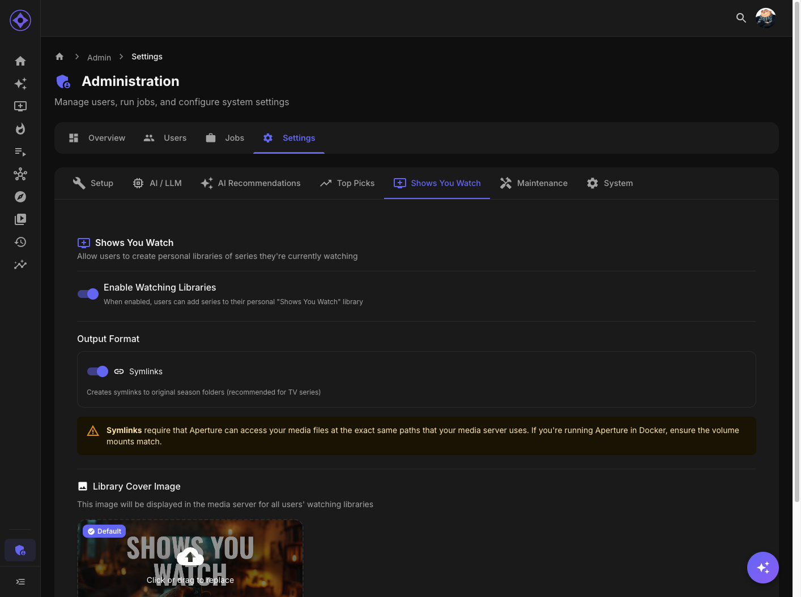

# Shows You Watch Configuration

Shows You Watch lets users maintain a followed-series list, view upcoming episodes and synchronize that list with Emby/Jellyfin series favorites.

## Configuration

Open **Admin → Settings → Shows You Watch**. The supported setting is **Enabled**. It controls feature visibility and media-server favorites synchronization; the default is enabled. There are no staleness, minimum-watched-episode, include-ended or separate generated-library naming settings for this feature.

Disabling the feature does not delete saved followed-series rows. Changing a feature setting is an explicit admin action; the episode-loading optimization does not change it.

## Membership and favorites

Users add/remove shows in Aperture. Additions favorite the series in Emby/Jellyfin; removals unfavorite it. **Sync favorites** performs a bidirectional reconcile, and the watching-favorites sync job can process enabled users. A completed or ended show can remain followed until the user removes it. Synced status drives the Airing filter, not automatic removal.

The list is stored per user in `user_watching_series`; the current implementation uses media-server favorites instead of creating an additional STRM library. Favorites displayed inside Emby/Jellyfin depend on the server/client's own behavior.

## Upcoming episode loading

Saved list data and local future episodes load without waiting for TMDb. Small authenticated forecast batches then enrich visible episode views. Membership is checked for each batch. Public forecasts share a bounded cache and concurrency limit across users; user lists are never shared. Failures preserve known data and allow a read-only retry without running favorites synchronization.

No API key, task schedule, preference or other existing setting is rewritten by this optimization. Existing TMDb configuration supplies the fallback credential. See [Upcoming Episodes loading](../upcoming-episodes-performance.md) for exact cache lifetimes, deadlines, ownership checks, measurements and validation, and [Shows You Watch](../features/shows-you-watch.md) for the user controls.
