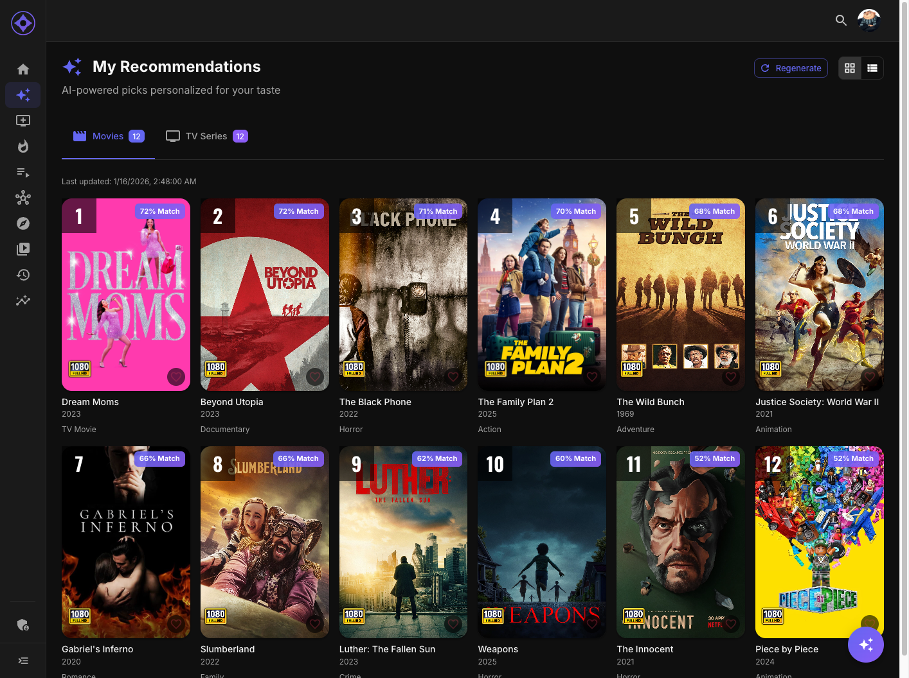

# Your AI Picks

The Recommendations page shows AI-generated personalized suggestions based on your watch history and ratings.

## Accessing Recommendations

Navigate to **Recommendations** in the sidebar (sparkle icon).

---

## How picks rotate

Aperture remembers titles selected for your account, including ones you did not play. Movies and shows normally wait 180 days before they can return. Your admin can adjust the two cooldowns separately. Only a limited number of returning titles can appear in a list.

Movie picks may also include well-rated films outside your most-watched genres. Shared themes from enriched metadata help rank candidates alongside your viewing history and ratings.

## Page Layout

### Tabs

Switch between content types:

- **Movies** — AI movie recommendations
- **Series** — AI series recommendations

### View Modes

Toggle between display modes:

| Mode | Description |
|------|-------------|
| **Grid View** | Poster grid with rank badges |
| **List View** | Detailed rows with match scores |

---

## Recommendation Display

### Rank Badges

Top recommendations show medal badges:

| Badge | Meaning |
|-------|---------|
| 🥇 Gold | #1 recommendation |
| 🥈 Silver | #2 recommendation |
| 🥉 Bronze | #3 recommendation |
| 4-50 | Numbered badge |

### Match Score

Each recommendation shows:

- **Percentage** — A ranking score derived from the recommendation algorithm
- **Visual bar** — Filled portion represents strength

---

## Understanding Recommendations

### Why This Pick?

Click any recommendation to see detailed insights:

#### Match Score Breakdown

| Factor | What It Measures |
|--------|------------------|
| **Taste Match** | Similarity to content you've enjoyed |
| **Discovery** | How much it expands your horizons |
| **Quality** | Community and critic ratings |
| **Variety** | How it diversifies your list |

#### Evidence Trail

Shows the specific items that influenced this recommendation:

> "Because you watched **Inception**, **The Prestige**, and **Memento**..."

Links to those items so you can see the connection.

#### AI Explanation

If enabled by your admin, a natural language explanation:

> "This psychological thriller shares the mind-bending narrative structure and atmospheric tension you enjoyed in Christopher Nolan's work..."

---

## How Recommendations Are Generated

### Input Data

Aperture builds a stored taste profile from completed plays and favorites. Engagement, explicit
ratings, and viewing recency affect the influence of those titles. It retrieves candidates using
embedding similarity, then applies your franchise, genre, and compatible custom-interest preferences.
Movie candidates can also receive a small bonus for themes shared by multiple history titles.

### Scoring Factors

| Factor | Description |
| --- | --- |
| **Similarity** | Match to your stored taste profile. |
| **Discovery** | A mix of familiar and unfamiliar genres relative to your viewing history. |
| **Quality** | Community ratings. |
| **Variety** | Genre and, for TV, network diversity within the selected list. |

You can customize these weights in [AI Algorithm Settings](user-settings/ai-algorithm.md).

### Exclusions

Content is excluded if:

- You've already watched it or progressed at least 5%, with watched content disabled
- You've rated that title ID 1–3 hearts, with exclude mode enabled
- Its source is disabled or inaccessible to your Emby account
- It is still within your suggestion cooldown

Library exclusions in Watcher Identity control which viewing history shapes your taste.
Taste profiles follow their refresh interval and lock settings.

---

## Refreshing Recommendations

Recommendations are generated by a scheduled job. To get fresh picks:

1. Ask your admin to run the recommendation job
2. Wait for the next scheduled run
3. Your watch activity will be synced first

**Note:** Watch history syncs before each recommendation run to ensure recently watched content is excluded.

---

## Recommendations in Your Media Server

Your admin chooses whether to publish AI Picks to the media server. Generated libraries use your configured title and present ranked picks. On Emby, your admin can also split TV picks into named source groups or publish them as private native playlists.

If private playlists are enabled, sign into Aperture with Emby so Aperture can create your playlists. Look for them under **Playlists** in Emby. They reference the original items in your libraries. Your Emby client controls where playlists appear on the home screen. If publishing is Off, your picks are available in Aperture.

See [Virtual Libraries](virtual-libraries.md) and [Output Format Configuration](../admin/output-format.md) for details.

---

## Improving Recommendations

### Rate More Content

- More ratings = better recommendations
- Rate items you've already watched
- Use the full 1-10 scale

### Be Honest About Dislikes

- Low ratings help avoid similar content
- Don't rate everything high
- The AI learns from what you don't like

### Customize Weights

In [AI Algorithm Settings](user-settings/ai-algorithm.md):

- Increase Similarity for more of what you like
- Increase Discovery for broader suggestions
- Increase Recency for newer content

### Review Your Identity

In [Watcher Identity](user-settings/watcher-identity.md):

- Check your detected franchises
- Adjust genre weights
- Regenerate your taste profile

---

**Next:** [Top Picks](top-picks.md)

## Tonight

Open **Tonight** in Aperture’s sidebar when signed in with Emby. Continue Watching shows up to four in-progress movies or episodes from the synced catalog. Tonight’s picks shows up to three eligible titles from your latest completed movie and TV runs and skips titles already in progress. **Open in Emby** opens the original movie, episode, or series in the Emby web client.

The page reads saved recommendations and current Emby playback state. It uses no model tokens and does not publish playlists or edit your Emby Home screen.

Choose **Not tonight** to hide a pick from Tonight for 12 hours. Aperture fills the list with the next eligible saved pick when one is available. This action applies to your account and leaves your ratings, taste profile, and published Emby playlists alone.
