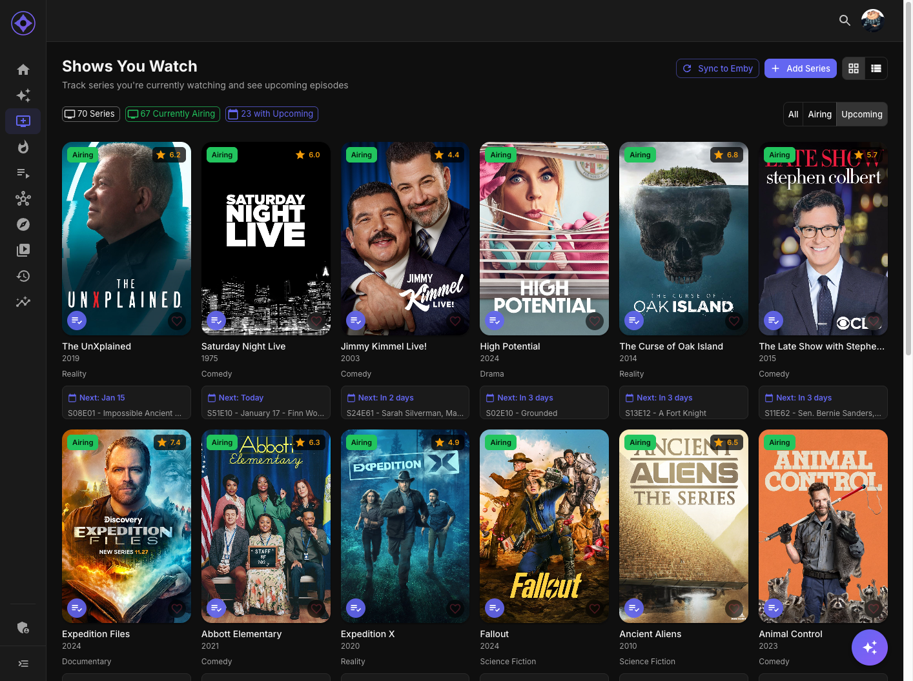

# Shows You Watch

Shows You Watch is your personal list of followed TV series, with upcoming episode information. Open it from the sidebar when the feature is enabled.

## Managing your list

Use **Add Series** to search the synced catalog and follow a show. Following a series in Aperture also favorites it in Emby/Jellyfin; removing it removes the corresponding server favorite. **Sync favorites** reconciles the list with your media-server series favorites. The scheduled favorites-sync job can reconcile enabled users as well.

A show does not automatically leave the list just because it ends or you finish watching it. Ended shows can remain followed; the **Airing** filter selects shows whose synced status is Continuing. There are no staleness or minimum-episode settings for this list.

## Views and filters

Choose **Grid** or **List** view. The **All**, **Airing** and **Upcoming** filters show their current counts; Upcoming is selected initially. Series with upcoming episodes sort by the soonest air date. Open a title for its detail page, or remove a show using its watching control.

## Upcoming episodes

Episode cards show season/episode number, title and air date when available. Local synced episode data is preferred; TMDb supplies a fallback schedule. A missing forecast means a future episode has not been confirmed, rather than a guarantee that the series has ended. Ended shows are still checked because synced status can be stale.

The saved list and local episodes load first. Remote forecasts fill in progressively while keeping available cards visible. A progress indicator shows that more information is loading. If some lookups fail, known episodes stay visible and a warning offers **Refresh**; this retries episode reads without syncing favorites or changing your list.

Forecast work runs only when Dashboard or Shows You Watch needs it. Public forecasts, including confirmed absence, are reused briefly; user membership stays separate and is checked against the server. No new configuration is required. See [Upcoming Episodes loading](../upcoming-episodes-performance.md) for cache lifetimes, ownership checks, failure handling and measurements.

## In Emby and Jellyfin

Shows You Watch uses the media server's series favorites. It does not create an additional STRM library. The media server and its clients control how favorites are displayed. Favorites synchronization is separate from refreshing the upcoming schedule.

**Next:** [Playlists](playlists.md)
