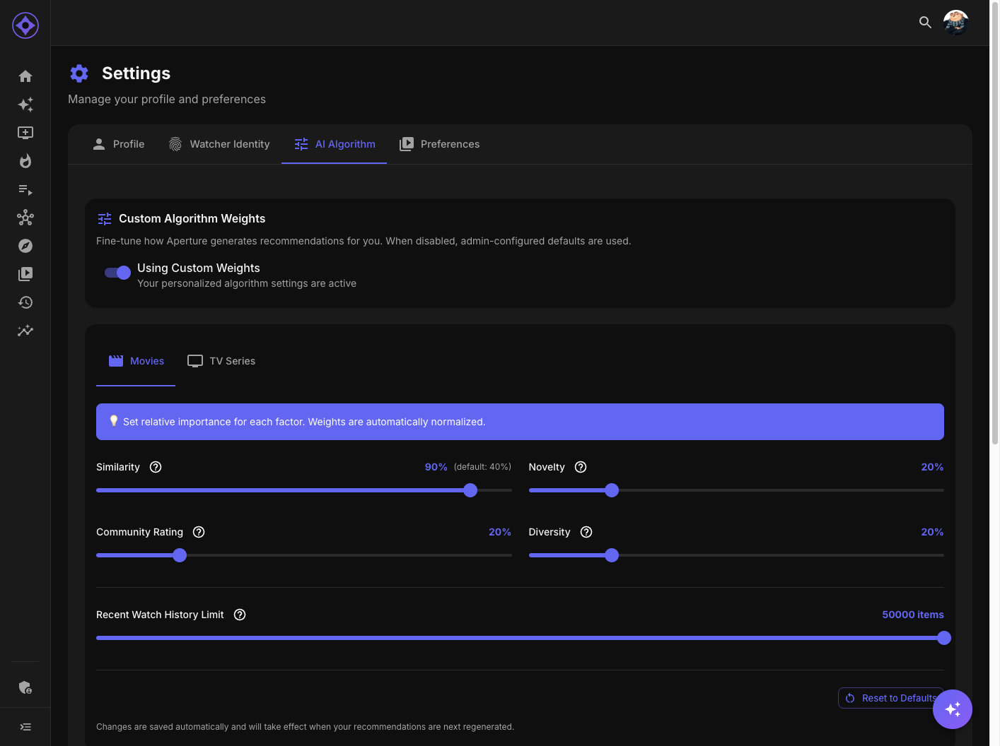

# AI Algorithm Weights

Adjust how Aperture ranks personalized movie and TV recommendations in **Settings → AI Algorithm**.
Movie and TV weights are configured separately. Enable custom settings to override the server defaults.

## The four weights

| Weight | Effect |
| --- | --- |
| **Similarity** | Favors candidates whose embeddings resemble your stored taste profile. |
| **Novelty** | Rewards some unfamiliar genres alongside genres from your viewing history. |
| **Community Rating** | Favors higher community ratings. Missing ratings receive a neutral fallback. |
| **Diversity** | Balances the picks already selected by genre and, for TV, network. |

The internal setting names are `similarityWeight`, `noveltyWeight`, `ratingWeight`, and
`diversityWeight`. The sliders show percentages, and Aperture normalizes the saved values by
their total when generating recommendations. For example, equal values give the four factors equal
relative weight. A zero value removes that factor's direct contribution to scoring.

Similarity, novelty, and community rating produce a base score. Aperture then applies franchise, genre,
and custom-interest preferences. Diversity is blended in during selection so it can change which
candidates enter the final list. An explicit custom diversity weight uses your normalized setting.
Server-default diversity can also adjust to how focused or varied your viewing history appears.

## Viewing history and preferences

Completed plays and favorites supply positive taste signals. Rewatches, TV completion, explicit
ratings, and the recency of viewing affect the stored taste profile. Partially played titles can be
excluded from new suggestions once playback reaches 5% while contributing to taste through an
explicit favorite.

Your excluded analysis libraries are omitted from profile building and history analysis. Your
admin's source-library configuration and Emby access determine which libraries can supply picks.

The recent-history limit controls the movie or TV sample used for discovery scoring and fallback
profile building. Stored taste profiles use the eligible history and their configured refresh interval.
Profile updates therefore follow the refresh and lock settings in Watcher Identity.

Custom interests influence the first 100 candidates after initial scoring. Their embeddings must
match the active embedding model. Existing interests saved with an older model can be recreated
with the current model to contribute again.

## Watched and disliked titles

**Include watched content** permits eligible rewatch suggestions. The suggestion cooldown and
returning-title limit still apply.

Titles rated 1–3 hearts follow the saved dislike behavior in both movie and TV generation.

| Behavior | Effect |
| --- | --- |
| **Exclude** | Removes explicitly disliked title IDs from the candidate list, including when rewatching is enabled. |
| **Penalize** | Reduces their score. For a positive score, 20% remains before variety is applied. |

Explicit ratings also affect the influence of watched titles when a taste profile is rebuilt.
See [Ratings](../ratings.md) for details.

## Saving and applying changes

Slider changes save automatically. They take effect when recommendations are next generated.
Use **Reset to Server Defaults** to return to your admin's weights.

For closer matches, increase similarity. For more exploration, increase novelty or diversity.
For a stronger preference for well-rated titles, increase community rating.

See [Your AI Picks](../recommendations.md) and [Watcher Identity](watcher-identity.md).
